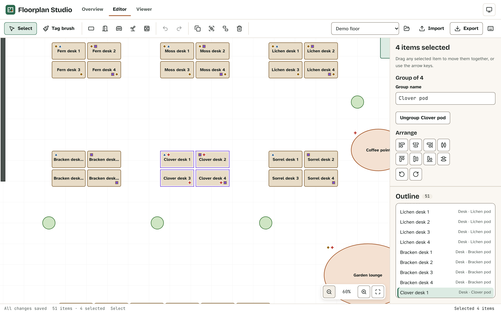
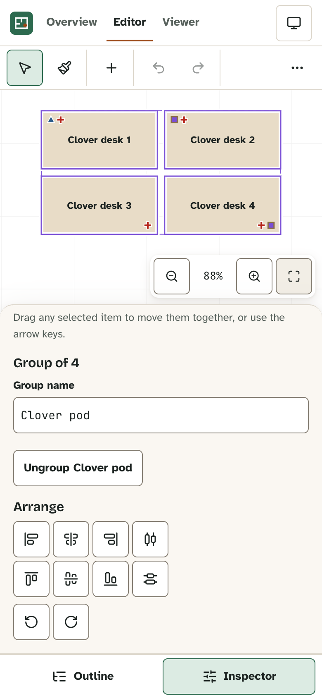

# Floorplan Studio

[](https://github.com/Nawfaldev19/svg-floorplan-studio/actions/workflows/ci.yml)
[](LICENSE)

A browser-based floor-plan editor for a co-working space, with an embeddable read-only viewer that highlights amenities. React 19, strict TypeScript and SVG, with no server.



## Engineering highlights

- **A framework-free core.** Every editing rule is a pure reducer case in [`src/core/editor.ts`](src/core/editor.ts), unit-tested in Node; lint keeps React out of `src/core`.
- **Undo built from invertible operations**, one step per gesture, with a held arrow key merged into one step and the selection restored ([`history.ts`](src/core/history.ts), [ADR 0003](docs/adr/0003-history-as-invertible-operations.md)).
- **Geometry in each item's local frame**, so hit tests and resizing work on rotated shapes, and turning a selection about the mean of its centres is exactly reversible ([`transform.ts`](src/core/transform.ts), [`arrange.ts`](src/core/arrange.ts)).
- **An editor that cannot write a plan it cannot read.** Imports and stored plans go through one validator; edits are clamped to the same limits; autosave validates before writing ([`document.ts`](src/core/document.ts), [ADR 0009](docs/adr/0009-editor-enforces-file-format-limits.md)).
- **Keyboard and touch parity for a canvas UI:** an outline list box, focus that survives disabled controls and layout changes, shortcuts scoped to focus, and pinch and pan on phones ([`EditorPage.tsx`](src/editor/EditorPage.tsx), [ACCESSIBILITY.md](ACCESSIBILITY.md)).
- **A strict Content Security Policy with Trusted Types**, enforced while every end-to-end test runs ([`vite.config.ts`](vite.config.ts), [ADR 0012](docs/adr/0012-strict-content-security-policy.md)).

## Quick start

Requires Node.js 22.12+ or 24+.

```bash
npm ci
npm run dev    # http://localhost:5173
```

The demo floor loads with no login; edits autosave to this browser. The [tutorial](docs/tutorials/getting-started.md) walks through a first session. To run every check: `npx playwright install chromium` once, then `npm run verify`.

## Features

| ID                                                                           | Feature                                                                     |
| ---------------------------------------------------------------------------- | --------------------------------------------------------------------------- |
| [F-01](docs/reference/features.md#f-01-canvas-navigation)                    | Canvas navigation: wheel, pinch, keys and buttons; fit to selection or plan |
| [F-02](docs/reference/features.md#f-02-selection-and-marquee)                | Group-aware selection, Shift-toggle, marquee and select all                 |
| [F-03](docs/reference/features.md#f-03-move-and-snap)                        | Move with grid snapping, nudge with arrow keys, Escape to cancel a drag     |
| [F-04](docs/reference/features.md#f-04-resize-and-rotate)                    | Resize from eight handles and rotate, correct for rotated items             |
| [F-05](docs/reference/features.md#f-05-add-tools)                            | Add desks, meeting rooms, lounges, planters and walls                       |
| [F-06](docs/reference/features.md#f-06-duplicate-copy-cut-and-paste)         | Duplicate, copy, cut and paste with numbered names                          |
| [F-07](docs/reference/features.md#f-07-align-distribute-and-rotate-by-steps) | Align, distribute and rotate a selection as one shape                       |
| [F-08](docs/reference/features.md#f-08-undo-and-redo)                        | Undo and redo that restore the selection                                    |
| [F-09](docs/reference/features.md#f-09-grouping-and-renaming)                | Groups and renaming                                                         |
| [F-10](docs/reference/features.md#f-10-amenity-tags-and-the-tag-brush)       | Amenity tags and the tag brush                                              |
| [F-11](docs/reference/features.md#f-11-outline-list-box)                     | Outline list box with multi-select                                          |
| [F-12](docs/reference/features.md#f-12-inspector-and-numeric-fields)         | Inspector with numeric fields                                               |
| [F-13](docs/reference/features.md#f-13-viewer-with-amenity-highlighting)     | Viewer with amenity highlighting and details                                |
| [F-14](docs/reference/features.md#f-14-embeddable-planviewer-component)      | Embeddable `PlanViewer` component                                           |
| [F-15](docs/reference/features.md#f-15-autosave-and-recovery)                | Validated autosave, backup of an unreadable plan, warning for a second tab  |
| [F-16](docs/reference/features.md#f-16-import-and-export)                    | JSON import and export with limits and a version migration                  |
| [F-17](docs/reference/features.md#f-17-presets-stress-floor-and-culling)     | Presets, a 3,000-desk stress floor and viewport culling                     |
| [F-18](docs/reference/features.md#f-18-shortcut-help)                        | Shortcut help generated from the keymap                                     |
| [F-19](docs/reference/features.md#f-19-landing-page-and-navigation)          | Landing page, routing and focus management                                  |
| [F-20](docs/reference/features.md#f-20-error-boundary)                       | Error boundary per view                                                     |
| [F-21](docs/reference/features.md#f-21-accessibility-features)               | Skip link, live region, roving toolbar, scoped keys, target sizes           |
| [F-22](docs/reference/features.md#f-22-themes)                               | Light, dark and system themes                                               |
| [F-23](docs/reference/features.md#f-23-responsive-layout-and-touch)          | Responsive layout with drawers and menus, touch drag, pan and pinch         |



More screenshots: [dark theme](docs/assets/editor-desktop-dark.png), [viewer](docs/assets/viewer-highlight.png).

## Tech stack

React 19 and TypeScript (strict), SVG rendering ([ADR 0002](docs/adr/0002-svg-instead-of-a-canvas-library.md)), Vite, Zod, Lucide icons; Vitest in Node and Chromium, Playwright, ESLint with TSDoc checks, knip and Prettier.

## Documentation

The [documentation map](docs/README.md) groups tutorials, how-to guides, reference and explanation, and lists the conventions followed. Start with the [architecture](docs/explanation/architecture.md), the [decision records](docs/adr/README.md) or the [test strategy](docs/testing/strategy.md).

## Limitations

- One user and one browser: plans live in `localStorage`; two tabs warn each other but the last save wins.
- Resize handles act on one item; shapes are rectangles and ellipses.
- The outline renders every item rather than a virtualised window.
- Touch is tested in emulated Chromium phone and tablet viewports, not on devices.

## Security, accessibility, contributing

- **Security:** report vulnerabilities as described in [SECURITY.md](SECURITY.md); design in the [threat model](docs/security/threat-model.md).
- **Accessibility:** target WCAG 2.2 AA; what was checked is in [ACCESSIBILITY.md](ACCESSIBILITY.md).
- **Contributing:** [CONTRIBUTING.md](CONTRIBUTING.md) and the [code of conduct](CODE_OF_CONDUCT.md); changes are in the [CHANGELOG](CHANGELOG.md).

## Author

Nawfal Imran · [GitHub](https://github.com/Nawfaldev19) · [LinkedIn](https://www.linkedin.com/in/nawfal-imran-886b13218)

## License

[MIT](LICENSE). Third-party packages, fonts and icons: [THIRD_PARTY_NOTICES.md](THIRD_PARTY_NOTICES.md).
