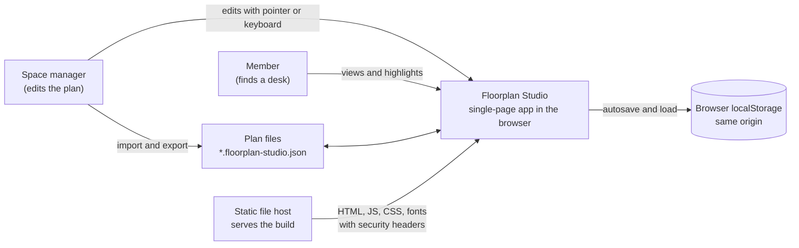
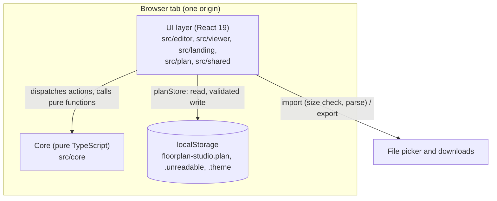
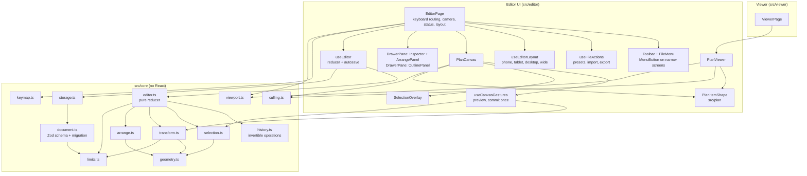
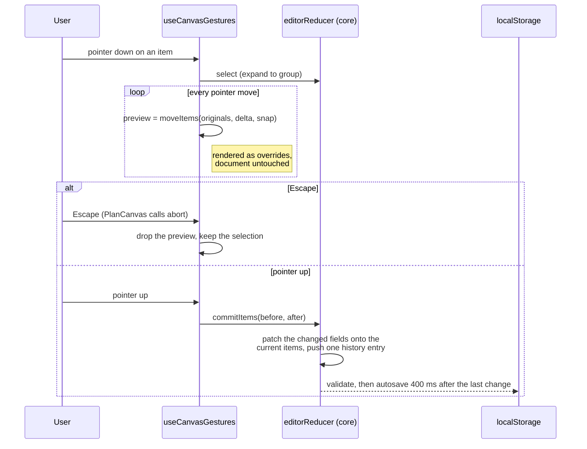
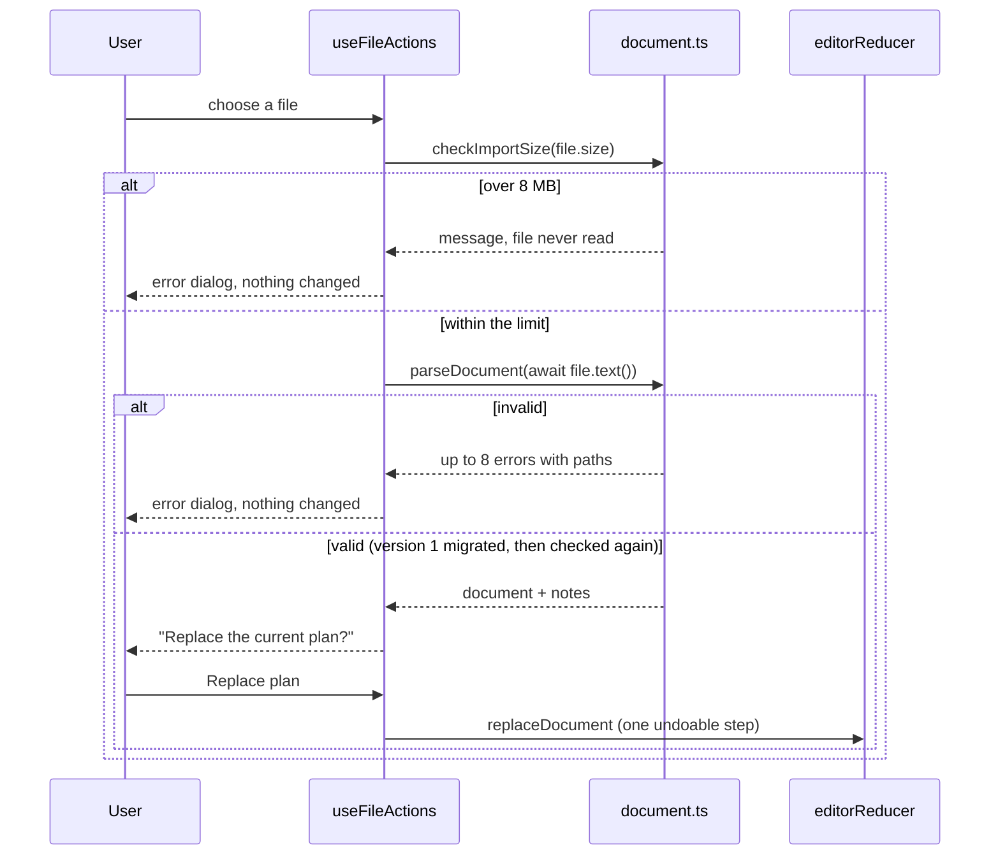
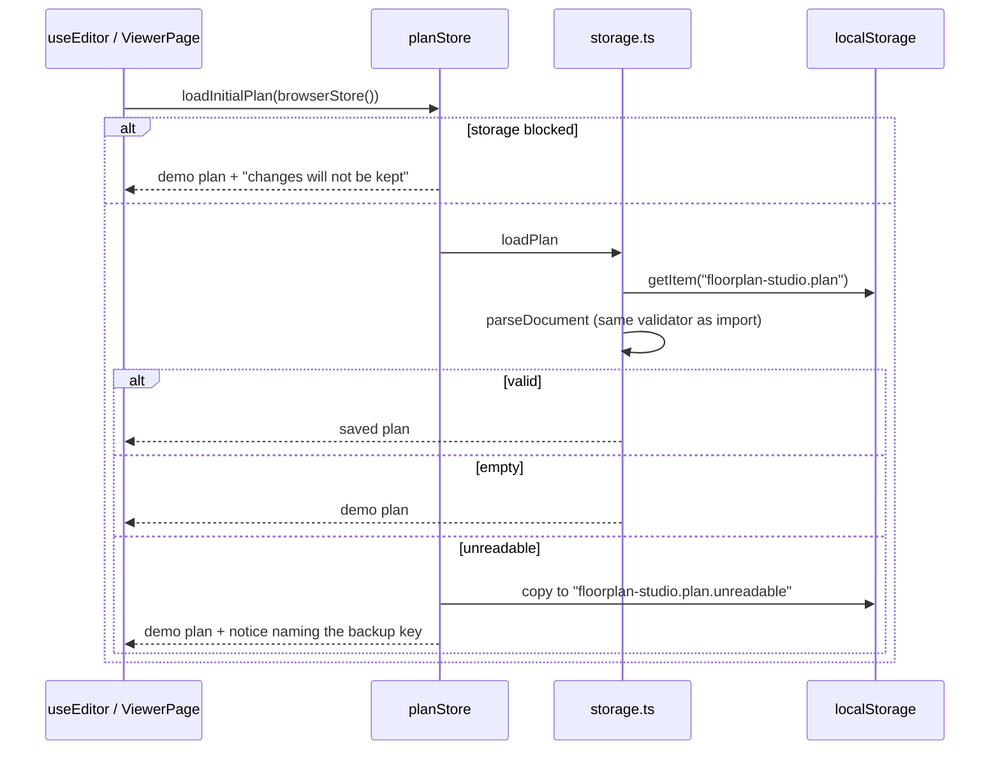

# Architecture

A reduced [arc42](https://arc42.org) outline with [C4](https://c4model.com) diagrams (levels 1 to 3) in Mermaid.

## 1. Goals

Product goal, non-goals and definition of done are in [scope.md](scope.md); how each quality goal is tested is in the [test strategy](../testing/strategy.md). In priority order:

1. **No data loss:** no sequence of edits produces a plan the app cannot load ([ADR 0009](../adr/0009-editor-enforces-file-format-limits.md)).
2. **Operable without a pointer,** to WCAG 2.2 AA ([ACCESSIBILITY.md](../../ACCESSIBILITY.md)).
3. **Correct geometry for rotated items** ([geometry-and-history.md](geometry-and-history.md)).
4. **Untrusted input cannot break the page** ([threat model](../security/threat-model.md)).
5. **Responsive with a few thousand items:** zoomed into the 3,000-desk floor, fewer than 300 items are in the DOM. No frame-time figures are claimed.

## 2. Constraints

- No server, accounts or network calls after load; plans live in `localStorage`.
- Plain static files with hash routing, so hosts need no rewrites.
- Permissive dependency licences ([THIRD_PARTY_NOTICES.md](../../THIRD_PARTY_NOTICES.md)).
- A Content Security Policy without `'unsafe-inline'` or `'unsafe-eval'` ([ADR 0012](../adr/0012-strict-content-security-policy.md)).
- Strict TypeScript, including `exactOptionalPropertyTypes` and `noUncheckedIndexedAccess`.
- Node.js 22.12+ or 24+; CI uses the version in `.nvmrc`.

## 3. Context (C4 level 1)

Only imported files, the stored plan and the static assets cross a trust boundary.

## 4. Building blocks

### Containers (C4 level 2)

The UI depends on the core, never the reverse; ESLint fails if `src/core` imports React or a UI folder ([ADR 0001](../adr/0001-framework-free-core.md)).

### Components of the editor (C4 level 3)

Decisions behind these blocks: the history ([ADR 0003](../adr/0003-history-as-invertible-operations.md)), gesture previews ([ADR 0004](../adr/0004-preview-gestures-outside-the-document.md)), validation ([ADR 0006](../adr/0006-validate-every-import-then-normalise.md)), the keymap ([ADR 0010](../adr/0010-one-keymap-with-canvas-scoped-keys.md)) and the responsive layout ([ADR 0015](../adr/0015-responsive-editor-with-drawers-and-overflow-menu.md)). Per-file responsibilities are in [project-structure.md](../reference/project-structure.md).

## 5. Runtime

### Dragging items

Zoom and pan stay outside the reducer and its history: zooming is not an edit.

### Importing a file

### Loading at startup

## 6. Deployment and CI

`npm run build` writes static files to `dist/` for any static host; there are no services, so no Docker setup. Hosting steps, hidden source maps and the `<meta>` policy fallback are in [deploy-the-static-build.md](../how-to/deploy-the-static-build.md); the headers are in [ADR 0013](../adr/0013-security-headers-and-build-time-csp.md).

[`ci.yml`](../../.github/workflows/ci.yml) runs on pushes to `main` and on pull requests. Job `verify` runs the steps of `npm run verify`: lint, knip, format check, type check, unit and component tests with coverage, build, then end-to-end tests in Chromium. Job `supply-chain` fails on a high or critical advisory in runtime dependencies, reports advisories in the rest, and uploads a CycloneDX SBOM. Dependency review and Scorecard run as separate workflows ([supply-chain.md](../security/supply-chain.md)). Actions are pinned to full commit SHAs.

## 7. Cross-cutting concepts

### Document model

A plan is an ordered item list plus a group list ([`types.ts`](../../src/core/types.ts)). Items are centre-anchored, in centimetres and clockwise degrees ([ADR 0005](../adr/0005-centre-anchored-items-and-degrees.md)). Array order is paint order, so later items draw on top and win hit tests. Groups are labels without a transform; ids come from a counter ([rule](geometry-and-history.md#ids-for-new-items)). [`limits.ts`](../../src/core/limits.ts) bounds the format, and both importer and reducer enforce it. The UI is English only, and titles format numbers with `toLocaleString('en-US')`.

### Validation and errors

Untrusted text, imported or stored, enters only through [`parseDocument`](../../src/core/document.ts), and every save passes it first ([threat model](../security/threat-model.md)). React renders names as text. An error boundary per view shows fixed recovery text with a Reload button, never the error, and nothing is logged.

### Page-level handlers

Every `window.on…` and `document.on…` handler goes through [`pageHandlers.ts`](../../src/shared/pageHandlers.ts) (`subscribe`, or `usePageHandler` in components). It installs one property handler per target and name and fans out to the subscribers, so no code can overwrite another subscriber. [`page-handlers.test.ts`](../../tests/unit/page-handlers.test.ts) fails if any other module assigns one. React props are used wherever React can attach the handler. An element handler has a single owning hook: `svg.onwheel` belongs to [`useWheelZoom`](../../src/plan/useWheelZoom.ts).

### Input and layout

Shortcuts resolve in the editor's `onKeyDown`, with scopes and the page-body fallback described in [ADR 0010](../adr/0010-one-keymap-with-canvas-scoped-keys.md). Touch arrives as pointer input and uses the mouse's gesture hook. [`useEditorLayout`](../../src/editor/useEditorLayout.ts) picks one of four layouts by width and exposes it as `data-layout`, so CSS and script share breakpoints; drawers and breakpoint focus are in [ADR 0015](../adr/0015-responsive-editor-with-drawers-and-overflow-menu.md).

### Rendering

[`visibleItems`](../../src/core/culling.ts) culls items and selection outlines to the view plus a 64 px margin ([feature catalogue](../reference/features.md)). `PlanItemShape` is memoised, so a drag re-renders only the moving items, and handle and label sizes are divided by the scale. [`shortenToWords`](../../src/core/text.ts) cuts labels between words using an average glyph width of about 0.54 em, so a label stays a prefix of the accessible name (WCAG 2.5.3); when no word fits, none is drawn.

### Persistence

Autosave runs 400 ms after the last change and flushes before navigation and when the page is hidden ([feature catalogue](../reference/features.md)). When another tab saves the same plan, the status bar shows an alert; nothing is merged and the last save wins ([threat model](../security/threat-model.md)).

## 8. Risks and technical debt

- **SVG node count** limits plans far beyond the 10,000-item cap ([ADR 0002](../adr/0002-svg-instead-of-a-canvas-library.md)).
- **The outline renders every item.** `content-visibility: auto` and memoised options help; a virtualised list is the next step.
- **Touch is automated only in emulated Chromium viewports**; device regressions are found by hand ([test strategy](../testing/strategy.md)).
- **Each new edit type needs a correct inverse**, checked by the seeded round-trip test.
- **Estimated glyph width:** a label can drop a word that fits; the full name is in the outline, inspector and accessible name.
- **Trusted Types fail closed** on any untested HTML-string path ([ADR 0013](../adr/0013-security-headers-and-build-time-csp.md)).
- **A workflow problem shows only on GitHub**; `npm run verify` runs the `verify` steps locally.

## 9. Glossary

Domain terms are in [glossary.md](../reference/glossary.md).
