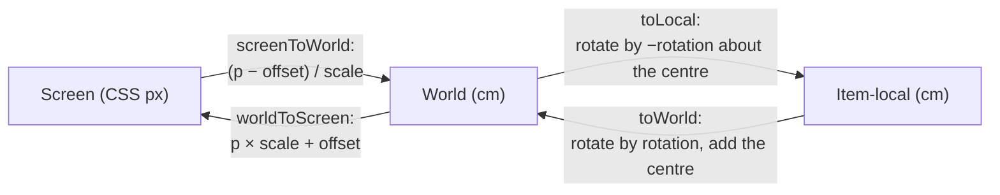

# Geometry, history and input handling

Design notes behind undo, rotated-item geometry and input; the overview is [architecture.md](architecture.md).

## History: invertible operations, not snapshots

The six operation types and the choice of operations over snapshots are in [ADR 0003](../adr/0003-history-as-invertible-operations.md). `invertChange` ([`history.ts`](../../src/core/history.ts)) inverts each operation, reverses their order and swaps the recorded selection; deletions are recorded from the highest index down, so indexes stay valid. `applyChange` copies the item array once and looks items up in an index map, so a 3,000-item move is linear.

**Memory** scales with what changed (a drag of three desks stores three patches), except for replacements: a `replace` from a preset or import holds two whole documents, so 200 of them on the 3,000-desk floor keep 400 plans. A seeded test in [`history.test.ts`](../../tests/unit/history.test.ts) checks that 500 random changes, each undone, return the exact original document.

**One step per gesture.** Drags, resizes, rotations and brush strokes are previewed outside the document and committed once, on pointer up ([ADR 0004](../adr/0004-preview-gestures-outside-the-document.md)).

**Held arrow keys.** A `nudge` carries its time (`at`), and `record` merges it into the previous step when the selection is the same, nothing was undone in between and the gap is within `COALESCE_WINDOW_MS` (1000 ms). Patches to one item fold together, so a long burst is as small as one step.

**Stale gestures.** If Delete or Ctrl+Z changes the document mid-drag, the release commits nothing, and `commitItems` skips items that no longer exist, so `applyChange` cannot throw.

## Ids for new items

The reducer mints `item-N` and `group-N` from a forward-only counter in editor state ([`editor.ts`](../../src/core/editor.ts)). It starts above the highest such suffix in the plan, counting only suffixes of up to 15 digits, so it stays a safe integer. Minting skips ids already in use, so huge or clashing imported ids never produce invalid ids or break autosave.

## Coordinates

Screen is CSS pixels relative to the SVG; item-local is centred on the item with axes along it ([`viewport.ts`](../../src/core/viewport.ts), [`geometry.ts`](../../src/core/geometry.ts)).

- **Hit testing** happens in the local frame, where a rotated rectangle is an ordinary one and an ellipse uses its equation ([`itemContainsPoint`](../../src/core/geometry.ts)); thin walls get a tolerance.
- **Resizing a rotated item** measures the new size in the local frame from the fixed opposite corner and maps only the new centre back, so that corner never drifts ([`resizeItem`](../../src/core/transform.ts)).
- **Zooming** and pinching keep the world point under the cursor or fingers fixed ([`viewport.ts`](../../src/core/viewport.ts)).
- **Arranging** uses rotated bounds. A multi-selection rotates as one shape about the mean of the item centres ([`rotateItemsBy`](../../src/core/arrange.ts), [ADR 0011](../adr/0011-multi-selection-rotates-about-its-centre.md)). That point turns with the shape, so +θ then −θ restores the layout and 24 turns of 15° return to the start, which a seeded test checks on uneven layouts. Turned positions are off-grid; a later drag snaps only the grabbed item and keeps the others' offsets.

## Input

Bindings are in [keyboard.md](../reference/keyboard.md) and gesture behaviour in the [feature catalogue](../reference/features.md). The less obvious choices:

- **Wheel:** [`useWheelZoom`](../../src/plan/useWheelZoom.ts) owns `svg.onwheel`, because React's wheel handler is passive and cannot cancel Ctrl+wheel page zoom. It honours `deltaMode`, so line-based wheels move as far per notch as pixel ones.
- **Pointers:** capture keeps a drag alive outside the SVG. A third finger during a pinch is ignored, and nothing new starts until every finger lifts.
- **Pressing inside a selection** keeps it for dragging; a release without a drag narrows it to that item or group.
- **Space to pan** is forgotten when the window loses focus, so a release elsewhere cannot leave pan mode stuck.
- **Keys** come from one table, [`KEYMAP`](../../src/core/keymap.ts), read by `resolveShortcut`, the "?" dialog and keyboard.md (a unit test keeps them in sync).

The [viewer](../../src/viewer/PlanViewer.tsx) owns zoom and pan while the host owns the selection and highlight. Its arrow order, `readingOrder`, groups items into 40 cm lines and then sorts by x, a comparison that stays transitive.
