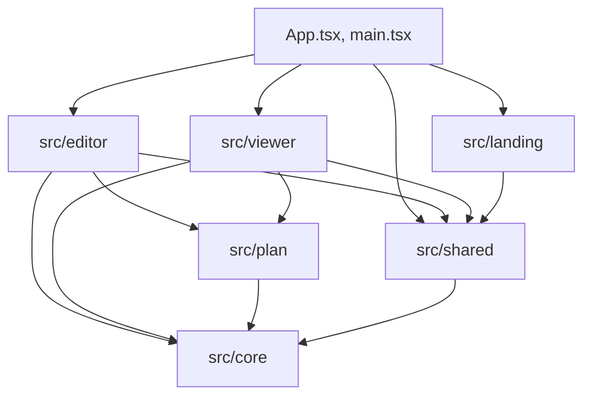

# Project structure

```text
svg-floorplan-studio/
├── .github/
│   ├── workflows/             CI (the full gate), dependency review, OpenSSF Scorecard
│   ├── ISSUE_TEMPLATE/        Bug and feature forms; blank issues off
│   ├── CODEOWNERS             Review ownership
│   ├── dependabot.yml         Weekly npm and GitHub Actions updates
│   └── PULL_REQUEST_TEMPLATE.md
├── docs/                      Documentation, organised by Diátaxis (see docs/README.md)
│   ├── tutorials/  how-to/  reference/  explanation/
│   ├── adr/                   Architecture decision records 0001–0015 (MADR 4.0.0 format)
│   ├── security/              Threat model, ASVS mapping, supply chain
│   ├── testing/               Strategy and traceability
│   └── assets/                Screenshots
├── public/favicon.svg         Copied into the build as is
├── src/
│   ├── core/                  Pure TypeScript: model, limits, geometry, history, reducer, keymap, file format, storage, seeds
│   ├── editor/                Canvas, gestures, toolbar, inspector, outline, drawers, file actions, layout and autosave hooks
│   ├── viewer/                The embeddable PlanViewer and the page that hosts it
│   ├── plan/                  SVG shared by editor and viewer: item shape, amenity glyphs, grid, wheel zoom
│   ├── landing/               The overview page
│   ├── shared/                Header, theme, button, menu button, dialog, error boundary, shortcut list, media queries, routes, storage access, page handlers
│   ├── styles/                Design tokens (light and dark) and base styles
│   ├── App.tsx                Hash routing, skip link, page titles, focus on navigation
│   └── main.tsx               Entry point
├── tests/
│   ├── unit/                  Vitest in Node: src/core, routes, plan store, keyboard reference, token contrast, page-handlers.test.ts
│   ├── component/             Vitest browser mode in Chromium, real reducer: panels, phone layout, viewer, editor-focus.test.tsx, canvas-gestures.test.tsx
│   └── e2e/                   Playwright against the production build under the security headers; touch.spec.ts for phone and tablet
├── index.html                 The single page
├── vite.config.ts             Build, ports, security headers, CSP meta plugin
├── vitest.config.ts           Unit and component projects, coverage thresholds
├── playwright.config.ts       Desktop, phone and tablet projects, the preview web server
├── eslint.config.js           Type-aware lint, the core import rule, TSDoc presence
├── tsconfig*.json             Strict TypeScript for the app and the tooling configs
├── README.md, CHANGELOG.md, CONTRIBUTING.md, SECURITY.md, ACCESSIBILITY.md, SUPPORT.md, CODE_OF_CONDUCT.md
└── LICENSE, THIRD_PARTY_NOTICES.md
```

`.gitignore` excludes the generated folders (`node_modules/`, `dist/`, `coverage/`, `test-results/`, `playwright-report/`, `.vitest/`). The [test strategy](../testing/strategy.md) describes the test files; [audit-accessibility.md](../how-to/audit-accessibility.md) is the accessibility audit.

## Dependency rules between layers



| Rule                                                                                                                           | Enforced by                                                                                                                               |
| ------------------------------------------------------------------------------------------------------------------------------ | ----------------------------------------------------------------------------------------------------------------------------------------- |
| `src/core` imports nothing from React or from any UI folder.                                                                   | `no-restricted-imports` in [`eslint.config.js`](../../eslint.config.js) ([ADR 0001](../adr/0001-framework-free-core.md)).                 |
| UI code reaches storage only through `src/shared/planStore.ts`, `src/core/storage.ts` and, for the theme key, `useTheme`.      | Review; no other source file mentions `localStorage`.                                                                                     |
| Untrusted text is parsed only by `parseDocument`.                                                                              | Review; the [threat model](../security/threat-model.md) lists every entry point.                                                          |
| Only `src/shared/pageHandlers.ts` assigns `window.on…` or `document.on…` handler properties; other code subscribes through it. | [`tests/unit/page-handlers.test.ts`](../../tests/unit/page-handlers.test.ts).                                                             |
| Every export in `src/` has a TSDoc comment.                                                                                    | `jsdoc/require-jsdoc` in [`eslint.config.js`](../../eslint.config.js) ([CONTRIBUTING.md → Code style](../../CONTRIBUTING.md#code-style)). |
| No unused files, exports or dependencies.                                                                                      | `npm run knip`.                                                                                                                           |
