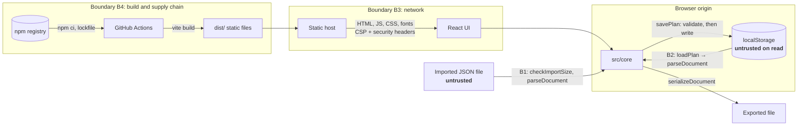

# Threat model

Floorplan Studio is a static build (HTML, one JavaScript bundle, CSS, self-hosted fonts) that runs entirely in the browser, with no server, accounts or network calls after load. Plans live in `localStorage` and travel as JSON files. A plan holds only the titles and names the user typed, so authentication, sessions, CSRF, CORS and server-side injection are out of scope.

The assets are the saved plan (corrupting it loses work), the integrity of the page (injected script could alter the plan), the editor's availability (a hostile file must not break it) and the build chain (a compromised dependency ships code to every user). This page applies STRIDE per trust boundary; see also [SECURITY.md](../../SECURITY.md), [asvs-mapping.md](asvs-mapping.md) and [supply-chain.md](supply-chain.md).

## Data flow and trust boundaries

## STRIDE per boundary

Test files are abbreviated: _doc_ = `tests/unit/document.test.ts`, _ed_ = `tests/unit/editor.test.ts`, _e2e-ed_ = `tests/e2e/editor.spec.ts`, _site_ = `tests/e2e/site.spec.ts`.

### B1: imported plan files

Entry: [`FileMenu.readFile`](../../src/editor/FileMenu.tsx) → [`checkImportSize`, `parseDocument`](../../src/core/document.ts).

| STRIDE | Threat                                                           | Mitigation                                                                                                                                                 | Where in code                 | Test                                                                                              | Residual risk                                   |
| ------ | ---------------------------------------------------------------- | ---------------------------------------------------------------------------------------------------------------------------------------------------------- | ----------------------------- | ------------------------------------------------------------------------------------------------- | ----------------------------------------------- |
| T      | Wrong types, unsafe or duplicate ids, dangling group references. | Zod schema with enumerated kinds and tags, ids `^[A-Za-z0-9_-]{1,64}$`, cross-field checks; a valid file applies after confirmation, as one undoable step. | `document.ts` `parseDocument` | _e2e-ed_ "rejects an invalid import and leaves the plan untouched"                                | Low.                                            |
| T      | A group id equal to an item id; repeated tags.                   | The clash is rejected (`groups: id "x" is also an item id`); up to 20 tag entries are accepted and duplicates removed.                                     | `document.ts` `normalize`     | _doc_ "rejects a group id that is also an item id", "accepts repeated tags and keeps one of each" | Low.                                            |
| T      | A version 1 file migrates to out-of-bounds values.               | The migrated document is validated again ([ADR 0014](../adr/0014-validate-migrated-files-against-current-schema.md)).                                      | `document.ts` `parseDocument` | _doc_ "checks the upgraded plan against the current bounds as well"                               | Low.                                            |
| T, E   | `__proto__` or `constructor` keys pollute prototypes.            | `JSON.parse` makes own properties; the schema drops unknown keys.                                                                                          | `document.ts`                 | _doc_ `drops unknown keys, including "__proto__", without touching any prototype`                 | Low.                                            |
| E      | Script in a name runs (XSS).                                     | React text nodes only; no `dangerouslySetInnerHTML`, `innerHTML` or `eval` in `src/`; Trusted Types block HTML-string sinks.                               | All components                | _site_ "markup in names is shown as text and never runs"                                          | Low.                                            |
| D      | A huge file, array or error list freezes the tab.                | Over 8 MB refused before reading; 10,000 items and groups at most; eight error lines plus a count; viewport culling; 200 history steps.                    | `document.ts`, `limits.ts`    | _doc_ "caps the error list so a hostile file cannot flood the dialog"                             | Medium-low: 8 MB parses slowly on weak devices. |
| D      | A tiny `gridSize` makes snapping and the grid degenerate.        | `gridSize` must lie between `MIN_GRID_SIZE` (1 cm) and `MAX_GRID_SIZE` (500).                                                                              | `limits.ts`                   | _doc_ "rejects a grid step below 1 cm, which would make snapping and the grid degenerate"         | Low.                                            |
| D      | Ids with huge numeric suffixes break id minting and autosave.    | Only `item-N`/`group-N` suffixes of up to 15 digits feed the counter; minting skips ids already in the plan.                                               | `editor.ts` `idMinter`        | _ed_ "mints distinct, valid ids after ids with huge numeric suffixes, so autosave keeps working"  | Low.                                            |
| I      | An export carries unexpected data.                               | Only title, grid size, items and groups.                                                                                                                   | `serializeDocument`           | _doc_ "round-trips the demo plan through JSON unchanged"                                          | None known.                                     |

Files carry no identities, so spoofing and repudiation do not arise.

### B2: browser storage

Entry: [`loadPlan`](../../src/core/storage.ts) and [`readChoice`](../../src/shared/useTheme.ts).

| STRIDE | Threat                                       | Mitigation                                                                                                      | Where in code             | Test                                                                                                             | Residual risk                                |
| ------ | -------------------------------------------- | --------------------------------------------------------------------------------------------------------------- | ------------------------- | ---------------------------------------------------------------------------------------------------------------- | -------------------------------------------- |
| T      | The stored plan is edited or corrupted.      | Validated like an import; on failure it is copied to a backup key, the demo loads and a notice names the copy.  | `storage.ts`              | _site_ "a corrupt saved plan falls back to the demo and is kept as a backup"                                     | Low.                                         |
| T      | A tampered theme value injects markup.       | Only `light` and `dark` are read; anything else means "system".                                                 | `useTheme.ts`             | _site_ "markup in names is shown as text and never runs"                                                         | None known.                                  |
| T      | The app saves a plan its own loader rejects. | The reducer enforces the format's limits; autosave validates first.                                             | `editor.ts`, `storage.ts` | `tests/unit/seed-storage-culling.test.ts` "refuses to save a plan the loader would reject, keeping the good one" | Low.                                         |
| T      | Two tabs autosave over each other.           | When another tab saves, the status bar alerts "Another tab saved this plan; saving here replaces that version." | `useEditor.ts`            | _e2e-ed_ "warns when another tab saves the same plan"                                                            | Medium-low: the last save wins; no merging.  |
| D      | Storage is full or blocked.                  | Every access is wrapped; the status bar says "Not saved" or "Not saved (storage unavailable)".                  | `planStore.ts`            | `tests/component/editor-page.test.tsx` "shows and announces a failed save"                                       | Low.                                         |
| I      | Another site reads the plan.                 | `localStorage` is per origin.                                                                                   | Browser                   | —                                                                                                                | Anyone with the browser profile can read it. |

### B3: delivery of the static files

Entry: [`vite.config.ts`](../../vite.config.ts) for `vite preview`; [deploy-the-static-build.md](../how-to/deploy-the-static-build.md) for other hosts. [ADR 0013](../adr/0013-security-headers-and-build-time-csp.md) lists every header.

| STRIDE | Threat                                        | Mitigation                                                                                                           | Where in code    | Test                                                                               | Residual risk                                        |
| ------ | --------------------------------------------- | -------------------------------------------------------------------------------------------------------------------- | ---------------- | ---------------------------------------------------------------------------------- | ---------------------------------------------------- |
| E      | Injected or third-party script runs.          | CSP with `script-src 'self'`, no `'unsafe-inline'` or `'unsafe-eval'`, Trusted Types; Zod runs `jitless`.            | `vite.config.ts` | _site_ "runs under the strict Content Security Policy without violations"          | The host must serve the files unmodified over HTTPS. |
| E      | The `<meta>` policy comes too late to apply.  | A `transformIndexHtml` hook (`order: 'pre'`) puts it right after `<meta charset>`; the build fails without that tag. | `vite.config.ts` | _site_ "sends the security headers, and the built page carries the policy as well" | Low.                                                 |
| I      | Data leaks over the network.                  | `connect-src 'none'`; self-hosted fonts; `Referrer-Policy: no-referrer`.                                             | `vite.config.ts` | _site_ CSP test (no request leaves the origin)                                     | None known.                                          |
| I      | Source maps expose more than the bundle.      | Built `'hidden'`: written but not linked, so browsers never fetch them. The source is public anyway.                 | `vite.config.ts` | —                                                                                  | None known.                                          |
| T      | Framing, MIME sniffing, cross-origin windows. | `frame-ancestors 'none'`, `X-Frame-Options`, `nosniff`, cross-origin opener and resource policies.                   | `vite.config.ts` | _site_ security-headers test                                                       | Other hosts must send the headers.                   |

### B4: dependencies and CI

Entry: [`package-lock.json`](../../package-lock.json) and [`.github/workflows/`](../../.github/workflows/).

| STRIDE | Threat                                  | Mitigation                                                                                                                                                   | Where                      | Verification                                                                              | Residual risk                                |
| ------ | --------------------------------------- | ------------------------------------------------------------------------------------------------------------------------------------------------------------ | -------------------------- | ----------------------------------------------------------------------------------------- | -------------------------------------------- |
| T      | A compromised or typo-squatted package. | Small runtime set; lockfile and `npm ci`; 14-day cooldown; Dependabot, dependency review, `npm audit`; CodeQL default setup, to enable after the first push. | `package-lock.json`        | [supply-chain.md](supply-chain.md)                                                        | A malicious release inside an allowed range. |
| T, E   | A hijacked workflow.                    | Actions pinned to commit SHAs; `contents: read` by default; `persist-credentials: false`; no untrusted input in `run:`.                                      | `.github/workflows/*.yml`  | Scorecard; OpenSSF Scorecard (Pinned-Dependencies, Token-Permissions, Dangerous-Workflow) | An action malicious at its pinned SHA.       |
| R      | No record of what went into a build.    | CycloneDX SBOM uploaded as a CI artifact.                                                                                                                    | `.github/workflows/ci.yml` | Artifact `sbom`                                                                           | The SBOM is not signed.                      |

## Abuse cases

1. **"Here is our new floor plan,"** with script in item names and 9,000 duplicate ids. The importer lists eight problems plus a count and changes nothing; with unique ids, names show as text and the plan applies only after confirmation.
2. **A file from another tool** with ids like `item-9007199254740993`. It imports, new desks still get valid ids, and autosave keeps working.
3. **A shared computer** where someone corrupts `floorplan-studio.plan`. The next visit backs it up to `floorplan-studio.plan.unreadable`, loads the demo and says so.
4. **Two tabs on one plan.** Saving in one raises the alert in the other; the last save wins.
5. **A version 1 file** with `angleRad: 1e308`, refused after migration with "after upgrading from version 1, …".
6. **A malicious Dependabot update.** Dependency review blocks high-severity advisories, and nothing merges without the CI gate.

## Review

Reviewed against the code on 2026-10-18 for version 1.0.0. Re-check when an input path, storage key, networked dependency or workflow is added.
